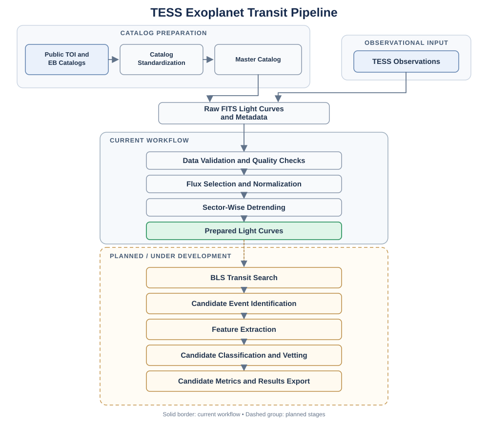

# TESS Exoplanet Transit Detection & Vetting Pipeline

A Python research project for building a reproducible workflow around **TESS light curves**: collecting observations, combining public catalog labels, preparing light curves for analysis, and developing toward automated transit-candidate detection and vetting.

The scientific goal is to help distinguish plausible planetary transits from noise and astrophysical false positives. Reliable vetting matters as much as finding periodic dips: dilution, period aliases, blended eclipsing binaries, grazing geometries, and model uncertainty can all lead to misleading candidate classifications.

> **Project status:** This repository snapshot contains the catalog, ingestion, and preprocessing foundations, plus two exploratory Jupyter notebooks. The downstream BLS detection, feature-extraction, machine-learning, and full transit-fitting/vetting stages are not yet included as complete implementations in this snapshot. See [Experimental validation notes](docs/experimental-validation-notes.md) for development notes whose end-to-end reproduction requires code not currently included here.

## What is implemented in this snapshot?

- **Catalog preparation:** standardizes TOI and eclipsing-binary catalog columns, maps catalog labels to project classes, merges records by TIC ID, and tracks conflicts and pipeline status.
- **TESS data ingestion:** uses [Lightkurve](https://lightkurve.org/) to search and download TESS light curves. The ingestion code can preserve source FITS files and write extracted light-curve tables as Parquet, along with JSON metadata.
- **Light-curve preprocessing:** validates the input schema and time ordering, selects a flux series, applies quality filtering, removes missing values, normalizes flux, and detrends observing sectors using Wōtan-based flattening.
- **Batch workflow:** records download/preprocessing status in the master catalog and writes logs for batch processing.
- **Notebook-based exploration:** documents the ingestion workflow and demonstrates individual and batch preprocessing, registry/selector use, and basic diagnostic plots.


## Pipeline Architecture



*The dashed section indicates planned stages that are under development.*

## Repository structure

```text
.
├── README.md
├── requirements.txt
├── .gitignore
├── docs/
│   └── experimental-validation-notes.md
├── notebooks/
│   ├── 01_data_ingestion.ipynb
│   ├── 02_pre_processing.ipynb
│   └── notebook_setup.py
├── src/
│   ├── config.py
│   ├── catalogs/          # Catalog processing and master-catalog construction
│   ├── ingestion/         # TESS download and batch-ingestion utilities
│   ├── preprocessing/    # Validation, cleaning, normalization, detrending
│   └── utils/             # Project initialization and shared constants
└── models/                # Reserved for future model artifacts
```

The `data/`, `plots/`, and `reports/` directories are created locally by project initialization as needed. They are intentionally not committed with the source snapshot.

## Setup

Python 3.10+ is recommended. Use a virtual environment so the project dependencies stay isolated.

### 1. Clone the repository

Replace the URL with your GitHub repository URL after creating the repository.

```bash
git clone https://github.com/DarXSouls/TESS_Exoplanet_transit_Pipeline.git
cd TESS_Exoplanet_transit_Pipeline
```

### 2. Create and activate an environment

**Linux / macOS / WSL**

```bash
python3 -m venv .venv
source .venv/bin/activate
python -m pip install --upgrade pip
```

**Windows PowerShell**

```powershell
py -m venv .venv
.venv\Scripts\Activate.ps1
python -m pip install --upgrade pip
```

### 3. Install dependencies

```bash
python -m pip install -r requirements.txt
```

### 4. Launch the notebooks

```bash
jupyter lab
```

Open `notebooks/01_data_ingestion.ipynb` first, then `notebooks/02_pre_processing.ipynb`. The shared `notebooks/notebook_setup.py` adds `src/` to Python's import path and initializes the local project directory structure.

> **Before running:** The notebooks are exploratory and include example TIC IDs and expected local data paths. Check that the IDs and paths refer to the same target and that any required catalog CSV files and downloaded light curves exist. The notebooks may need small adjustments for a fresh environment because this snapshot does not include the generated catalogs or observational data.

## Data and generated files

The project is designed to retrieve public TESS observations at run time rather than commit large datasets to Git. The ingestion code can store:

- **FITS:** original downloaded light-curve products.
- **Parquet:** tabular time-series data for efficient repeat access.
- **JSON:** observation and preprocessing metadata.
- **CSV:** processed catalog, master-catalog, and batch-log tables.

Generated data, local environments, bytecode, and notebook checkpoints are excluded by `.gitignore`. Keep the raw observations and other generated data locally; do not commit large data products unless there is a clear reason and the data's redistribution terms permit it.

## Current workflow

1. **Prepare catalog labels.** Process the TOI and eclipsing-binary catalogs, standardize key fields, and construct a master catalog keyed by TIC ID.
2. **Ingest light curves.** Search/download TESS observations and store source files plus analysis-friendly tables and metadata.
3. **Preprocess targets.** Validate data, select a flux series, filter poor-quality or missing samples, normalize the flux, and detrend by observing sector.
4. **Inspect outputs.** Use the second notebook's diagnostics to examine the prepared time series, trend estimate, missing values, duplicate samples, and batch status.
5. **Extend the pipeline.** Implement and validate transit search, features, candidate classification, transit modeling, and false-positive diagnostics as separate tested modules.

## Planned next steps

- Add a reproducible Box Least Squares (BLS) transit-search module with period-alias checks.
- Extract transit and light-curve quality features with documented definitions.
- Evaluate classical ML and deep-learning classifiers against held-out, catalog-labeled targets.
- Add transit-model fitting with uncertainty estimates and explicit ambiguous outcomes.
- Add centroid/difference-image diagnostics to help identify blended eclipsing binaries.
- Add unit tests, a pinned environment/lock file, command-line entry points, and an end-to-end example using a small public target set.

## Scientific and engineering principles

- Preserve original observations and keep derived products separate.
- Track provenance, input catalog labels, and processing status.
- Treat preprocessing choices as measurable transformations, not invisible changes.
- Avoid overconfident classifications where posterior uncertainties or false-positive diagnostics are inconclusive.
- Report the distinction between **simulation/fit diagnostics**, **candidate-vetting confidence**, and **observational evidence**.

## Reproducibility and limitations

This is an evolving research codebase, not yet a packaged release. The current snapshot has no automated test suite, no committed example dataset, and no complete end-to-end transit-classification command. Example paths and IDs in the notebooks may require editing. Validation claims in the development notes are preserved for context but are not independently reproducible from the source files included in this snapshot.


## Acknowledgements

TESS observations are accessed through the public archive using Lightkurve. This repository is an independent research/software project; the presence of TESS data or references to a project context should not be read as an official endorsement by NASA, STScI, or ISRO.
